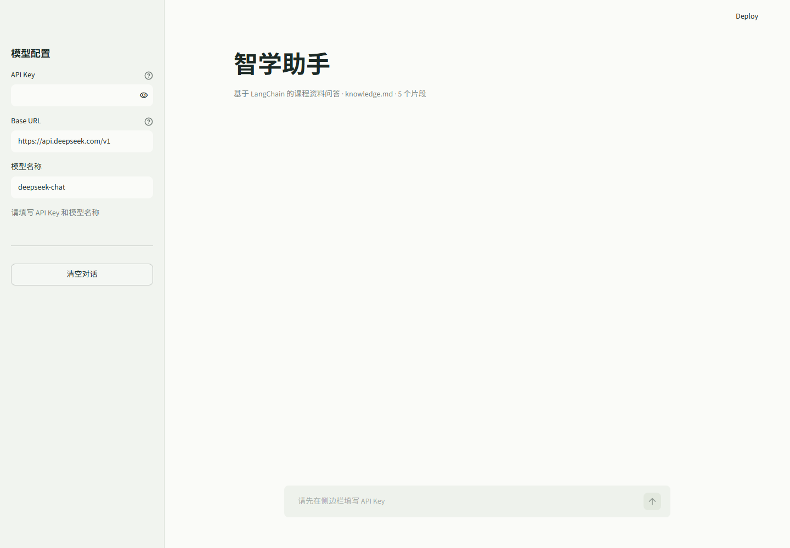

# 智学助手

基于 LangChain 和在线大模型的课程资料问答应用。应用从本地 Markdown 知识库检索相关片段，再通过 OpenAI 兼容接口调用大模型生成回答，并展示引用内容。

本项目用于完成《第七章 智能应用开发》作业，项目范围保持最小化：单页面、单个知识库、无数据库、无用户系统。

开源仓库：<https://github.com/MimiNuosi/zhixue-assistant>

## 界面预览



## 作业要求对应

| 作业要求 | 项目实现 |
| --- | --- |
| 基于 LangChain 框架 | 使用 LangChain Core、LCEL 提示词链、`ChatOpenAI` 和输出解析器 |
| 使用在线或离线大模型 | 通过 OpenAI 兼容接口接入 DeepSeek 在线模型 |
| 开发一款智能应用 | 实现课程资料检索、问答、引用展示和多轮页面交互 |
| README 文档说明 | 本文档包含功能、架构、配置、运行、测试和安全说明 |
| 开源仓库链接 | 使用 MIT License，仓库地址见本文顶部 |

## 功能

- 基于课程资料回答问题
- 使用 BM25 完成本地文本检索
- 使用 LangChain LCEL 组合提示词、聊天模型和输出解析器
- 展示回答引用的课程资料片段
- 支持任意 OpenAI 兼容聊天接口
- API Key 支持会话内输入或从 `.env` 读取

## 技术栈

| 组件 | 用途 |
| --- | --- |
| Python 3.11 | 运行环境 |
| Streamlit | Web 界面 |
| LangChain | 提示词、检索和模型调用编排 |
| BM25 | 本地课程资料检索 |
| ChatOpenAI | 调用 OpenAI 兼容在线模型 |
| python-dotenv | 读取本地环境变量 |

## 工作流程

```text
用户问题
   |
   v
BM25 检索本地课程资料
   |
   v
LangChain 提示词模板
   |
   v
在线大模型
   |
   v
回答 + 引用片段
```

## 项目结构

```text
智能应用开发/
├── app.py                  # Streamlit 页面与交互
├── rag.py                  # 知识库加载、检索和 LangChain 调用链
├── data/
│   └── knowledge.md        # 本地课程知识库
├── docs/
│   ├── screenshot-desktop.png
│   └── screenshot-mobile.png
├── tests/
│   ├── test_app.py         # 页面启动测试
│   └── test_rag.py         # 检索与文本处理测试
├── .env.example            # 环境变量示例
├── requirements.txt        # 运行依赖
├── requirements-dev.txt    # 开发和测试依赖
└── README.md
```

## 快速开始

### 1. 创建虚拟环境

Windows PowerShell：

```powershell
git clone https://github.com/MimiNuosi/zhixue-assistant.git
cd zhixue-assistant
python -m venv .venv
.\.venv\Scripts\Activate.ps1
```

如果 PowerShell 禁止运行激活脚本，可以不激活，直接使用 `.venv` 中的 Python：

```powershell
.\.venv\Scripts\python.exe -m pip install -r requirements-dev.txt
.\.venv\Scripts\python.exe -m streamlit run app.py
```

### 2. 配置在线模型

复制环境变量示例：

```powershell
Copy-Item .env.example .env
```

编辑 `.env`，填写自己的 API Key：

```dotenv
LLM_API_KEY=your_real_api_key
LLM_BASE_URL=https://api.deepseek.com
LLM_MODEL=deepseek-chat
```

也可以不创建 `.env`，启动后在页面左侧直接填写 API Key、Base URL 和模型名称。

常见 OpenAI 兼容配置示例：

```dotenv
# DeepSeek
LLM_BASE_URL=https://api.deepseek.com
LLM_MODEL=deepseek-chat

# 阿里云百炼兼容模式
LLM_BASE_URL=https://dashscope.aliyuncs.com/compatible-mode/v1
LLM_MODEL=qwen-plus

# 硅基流动
LLM_BASE_URL=https://api.siliconflow.cn/v1
LLM_MODEL=Qwen/Qwen2.5-7B-Instruct
```

具体模型名称以服务商控制台当前提供的模型为准。

### 3. 启动应用

```powershell
.\.venv\Scripts\python.exe -m streamlit run app.py
```

浏览器打开终端显示的本地地址，默认通常为：

```text
http://localhost:8501
```

## 示例问题

- LangChain 是什么？
- LCEL 的作用是什么？
- RAG 的处理流程有哪些步骤？
- 在线大模型和离线大模型有什么区别？
- 为什么 API Key 不能提交到公开仓库？
- 如何评测一个智能应用？

## 测试

```powershell
.\.venv\Scripts\python.exe -m pytest
```

测试覆盖知识库加载、文本切分、中文 BM25 检索和上下文格式化。模型调用需要有效 API Key，测试不会消耗在线 API 额度。

当前本地验证结果：`6 passed`，并已使用 DeepSeek API 完成真实问答测试。

## 安全说明

- 真实 API Key 只放在本地 `.env` 或页面会话中。
- `.env` 已加入 `.gitignore`，不会被提交到仓库。
- 如果密钥泄露，应立即在服务商控制台撤销旧密钥。

## 许可证

本项目使用 MIT License。
